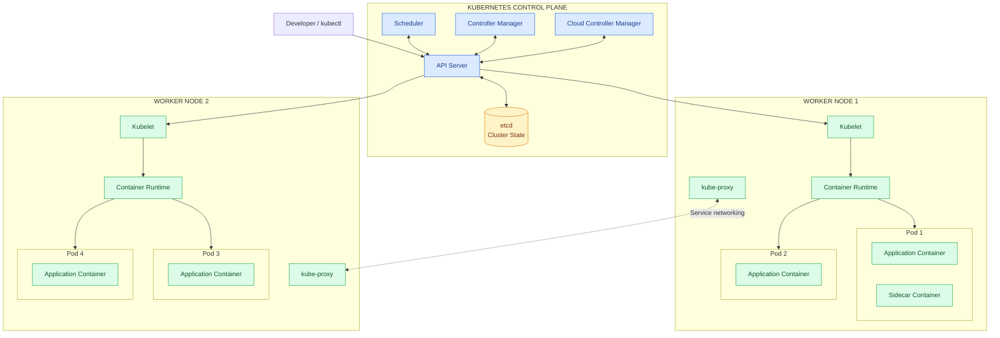

Containers are a good way to bundle and run your applications. In a production environment, 
you need to manage the containers that run the applications and ensure that there is no 
downtime.

Kubernetes provides you with a framework to run distributed systems resiliently. It takes 
care of scaling and failover for your application, provides deployment patterns, and more.

> **NOTE:** Kubernetes operates at the container level rather than at the hardware level.

---

### Functional Requirements

1. **Declarative desired-state management**: You describe the desired state of your 
application, and Kubernetes continuously works to make the actual state match that 
desired state.

---

### Non-Functional Requirements

1. Automated scaling
2. Self-healing 
3. Service discovery and load balancing 
4. Automated deployments and rollbacks
5. Resource Orchestration

---

### Kubernetes as a Distributed System: How Everything Works Together

To understand Kubernetes deeply, I want you to stop thinking of it as a tool that runs 
Docker containers.

Instead, think of Kubernetes as a distributed system consisting of multiple machines, each 
running specialized components that coordinate with one another to manage application 
workloads.

When you deploy Kubernetes, you are not installing one application on one machine. You are 
creating a cluster of machines that collectively behave like one computing platform.

#### What does a Kubernetes cluster actually consist of?

A cluster has two parts.

The control plane is the brain. The API server is the only front door. Every change goes 
through it. etcd stores the desired state and the current state. Controllers compare the 
two and act. The scheduler picks a node for each new container.

Worker nodes are the machines that actually run containers. ECS those machines are EC2 
instances managed by AWS. Each node runs a kubelet, which pulls the work assigned to that 
node and starts the containers.

Imagine you are building your Hotel Reservation System.

You have six microservices:
- User Service
- Hotel Service
- Search Service
- Inventory Service
- Reservation Service
- Payment Service

You want to deploy these services across multiple EC2 instances.

Let's say you provision four EC2 instances:
- 1 Control Plane Node
- 3 Worker Nodes

Each EC2 instance is an independent machine with its own:
- CPU and memory.
- Operating system.
- Network interface and IP address.
- Disk storage.
- Processes.

The machines communicate over a network.

| Machine | Role | Responsibility |
|--------|--------|--------|
| EC2-1 | Control Plane | Manages the cluster |
| EC2-2 | Worker Node 1 | Runs application Pods |
| EC2-3 | Worker Node 2 | Runs application Pods |
| EC2-4 | Worker Node 3 | Runs application Pods |


#### What is the Control Plane?

The Control Plane primarily consists of four components.

1. **API Server (communication gateway):** Every interaction with the Kubernetes cluster goes through it. It is the 
central communication interface of Kubernetes. Kubernetes components generally 
communicate through the API Server instead of directly modifying each other's internal 
state.

2. **etcd (cluster's persistent database):** A distributed key-value store that stores Kubernetes cluster state. In 
production, etcd is generally deployed with multiple members for high availability, 
typically three or five, rather than relying on a single instance.

3. **Scheduler (placement decision-maker):** Decides where a newly created Pod should run. It simply selects a 
suitable worker node and records the assignment through the API Server.

4. **Controller Manager (reconciliation engine):** Runs controllers that continuously 
monitor cluster resources. This is the foundation of Kubernetes self-healing.

#### What are Worker Nodes?

Worker Nodes are the machines that actually execute your application workloads. 

Unlike the Control Plane, which manages the cluster, Worker Nodes provide the compute 
resources for your applications. They primarily contain three components.

1. **Kubelet:** Node-level agent responsible for managing Pods assigned to this machine.
It communicates with the API Server and watches for Pods assigned to its node.

2. **Container Runtime:** Creates, starts, stops and manages containers.

3. **Kube-proxy:** Maintains networking rules that help route traffic addressed to the 
Service to the appropriate backend Pods.

---

### Kubernetes Architecture



---

### Sequence Flows

#### Deployment Flow

Developer → API Server → etcd → Controllers → Scheduler → Kubelet → Container Runtime → Pod.

1. **Submit the desired state**: The request reaches the API Server.

2. **Persist the desired state**: The API Server validates the Deployment specification and 
persists it in etcd.

3. **Create Pods**: The Deployment Controller observes the new Deployment and ensures that 
a corresponding ReplicaSet exists. The ReplicaSet Controller then creates the required 
Pod objects through the API Server.

4. **Schedule Pods**: The Scheduler observes Pods that don't have an assigned node. It 
selects suitable worker nodes and records the scheduling decisions through the API Server.

5. **Start containers**: The Kubelet on each selected worker node observes the assigned Pods.
It communicates with the container runtime to pull the image and start the containers.

#### Self-healing Flow 

Container crashes → Kubelet detects failure → Restart according to restart policy.

1. **Monitor and reconcile**: Controllers and Kubelets continue monitoring the cluster.
If one Pod disappears, the controllers work to create a replacement.

<Note>
If a Pod disappears, the ReplicaSet Controller can create a replacement.
</Note>

#### Networking Flow 

Application Pod → Kubernetes Service → Backend Pods.

<Note>
Something outside the cluster, typically the ingress or gateway in front of EKS, sends 
traffic to the service. The service picks a ready pod. The readiness comes from the 
health check using actuator.
</Note>

---

### What is a Pod?

A Pod provides a shared execution environment for one or more tightly coupled containers.

Technically speaking, containers inside the same Pod share:

1. **Network namespace**: They share the same IP address and can communicate using `localhost`.
2. **Storage volumes**: They can mount and access shared volumes.
3. **Lifecycle and scheduling**: They are scheduled together on the same worker node.

<Note>
They do not necessarily share the same filesystem or process namespace by default.
</Note>

#### Supports Sidecar Pattern 

Let's consider a simple example. You have a Reservation Service 
and a logging sidecar container. Both containers run inside one Pod. Because they share 
the network namespace, the logging agent can communicate with the application using 
`localhost`.

### How do we create a Pod?

```yaml
apiVersion: v1 # Specifies the Kubernetes API version
kind: Pod # Specifies the resource type

metadata: # Contains Pod name and labels
  name: reservation-pod
  labels:
    app: reservation-service

spec: # Defines the desired configuration
  containers: # Lists the containers running inside the Pod
    - name: reservation-container
      image: reservation-service:v1
      ports:
        - containerPort: 8080
```

You can create this Pod using:

```bash
kubectl apply -f reservation-pod.yaml
```

The following happens:

1. **API Server receives the request**: It authenticates, authorizes and validates the Pod specification.
2. **API Server persists the Pod**: The Pod specification is stored in etcd.
3. **Scheduler selects a worker node**: The Scheduler identifies a suitable node based on 
available resources and scheduling constraints.
4. **Kubelet detects the assigned Pod**: The Kubelet running on that worker node observes 
the Pod assignment through the API Server.
5. **Container runtime creates containers**: Kubelet communicates with containerd or 
another supported runtime to create the Pod's containers.
6. **Pod status is updated**: Kubelet reports the Pod's status back to the API Server.

Useful commands:

```bash
# List all Pods
kubectl get pods

# Get detailed information about a Pod
kubectl describe pod reservation-pod

# View Pod logs
kubectl logs reservation-pod

# Execute a command inside a container
kubectl exec -it reservation-pod -- /bin/sh

# Delete a Pod
kubectl delete pod reservation-pod
```

#### Why are Pods ephemeral?

Kubernetes treats Pods as replaceable units rather than permanent machines.
Therefore, applications should not depend on fixed Pod IP addresses.

Instead, Kubernetes provides Services, which offer stable network endpoints for 
communicating with Pods.

---

### Helm Chart

Helm:

1. Reads the chart.
2. Loads values.yaml.
3. Processes the templates.
4. Generates Kubernetes manifests.
5. Submits the resources to the Kubernetes API server.
6. Tracks the installation as a Helm release.

---

### Functional Requirements

1. `kube-apiserver`: 

2. `etcd`: Key-value store for storing the state of the cluster.

3. `controller-manager`:

4. `kube-scheduler`:

---

### Core Features

Kubernetes provides you with:

- **Service discovery and load balancing:** Kubernetes can expose a container using a DNS 
name or its own IP address. If traffic to a container is high, Kubernetes is able to load 
balance and distribute the network traffic so that the deployment is stable.

- **Automated rollouts and rollbacks:** You can describe the desired state for your deployed 
containers using Kubernetes, and it can change the actual state to the desired state at a 
controlled rate. For example, you can automate Kubernetes to create new containers for your 
deployment, remove existing containers and adopt all their resources to the new container.

- **Self-healing:** Kubernetes restarts containers that fail, replaces containers, kills 
containers that don't respond to your user-defined health check, and doesn't advertise 
them to clients until they are ready to serve.

- **Horizontal scaling:** Scale your application up and down with a simple command, with a UI, 
or automatically based on CPU usage.

- **Application-centric management:** Raises the level of abstraction from running an OS on 
virtual hardware to running an application on an OS using logical resources.

---

### Design Rationale

Q. Why pods?

```
// pod-definition.yaml
apiVersion: v1

```


---

### Architecture

A Kubernetes cluster consists of a control plane plus a set of worker machines, called nodes, 
that run containerized applications. In production environments, the control plane usually 
runs across multiple computers and a cluster usually runs multiple nodes, providing 
fault-tolerance and high availability.

---

### Low Level Design 

1. API Layer (Spring Boot REST Controller): Instead of Node.js with Express, you would use a 
Spring Boot REST Controller to accept incoming container deployment requests. You can use 
Spring Data JPA or MyBatis with a database like PostgreSQL to store your job states.

2. Job Dispatcher (Spring Scheduling): Rather than BullMQ, you can use Spring's native 
Scheduling capabilities (`@Scheduled`) to create a background task that polls your database 
for "submitted" jobs. You could also use an enterprise-grade job scheduling library like 
`JobRunr` if you require distributed job processing across multiple nodes.

3. CRI / Scheduler (Docker Java API): To interact with Docker, use the docker-java library, 
which provides a native Java SDK for the Docker Remote API. This allows your service to 
perform the same operations shown in the video—pulling images, creating containers, and 
monitoring their lifecycle.

Core Components Structure:

Repository Layer: Define a JobEntity to track image, command, status (PENDING, RUNNING, SUCCEEDED), and containerId.
Scheduler Service: Create a `@Service` class annotated with `@EnableScheduling` to handle the logic of polling the database and triggering the Docker interaction.
Docker Client Bean: Configure a `@Configuration` class to initialize the DockerClient object, allowing you to inject it into your services.
This approach gives you a robust foundation in Java for managing containerized workloads. Remember to handle thread safety (e.g., using AtomicLong or database locking) if you plan to run multiple scheduler instances to avoid race conditions when picking up jobs.

---

### Kubernetes Compoenents 

| Component | Runs where | Communication |
|--------|--------|--------|
| API Server | Control Plane | HTTP API |
| etcd | Control Plane / dedicated etcd machines | etcd protocol |
| Scheduler | Control Plane | Kubernetes API |
| Controller Manager | Control Plane | Kubernetes API |
| Kubelet | Every Worker Node | Kubernetes API |
| Container Runtime | Every Worker Node | Local CRI interface |
| kube-proxy | Worker Nodes, if deployed | Local networking rules |
| CNI Agent | Depends on implementation, commonly every Worker Node | Networking interfaces and APIs |