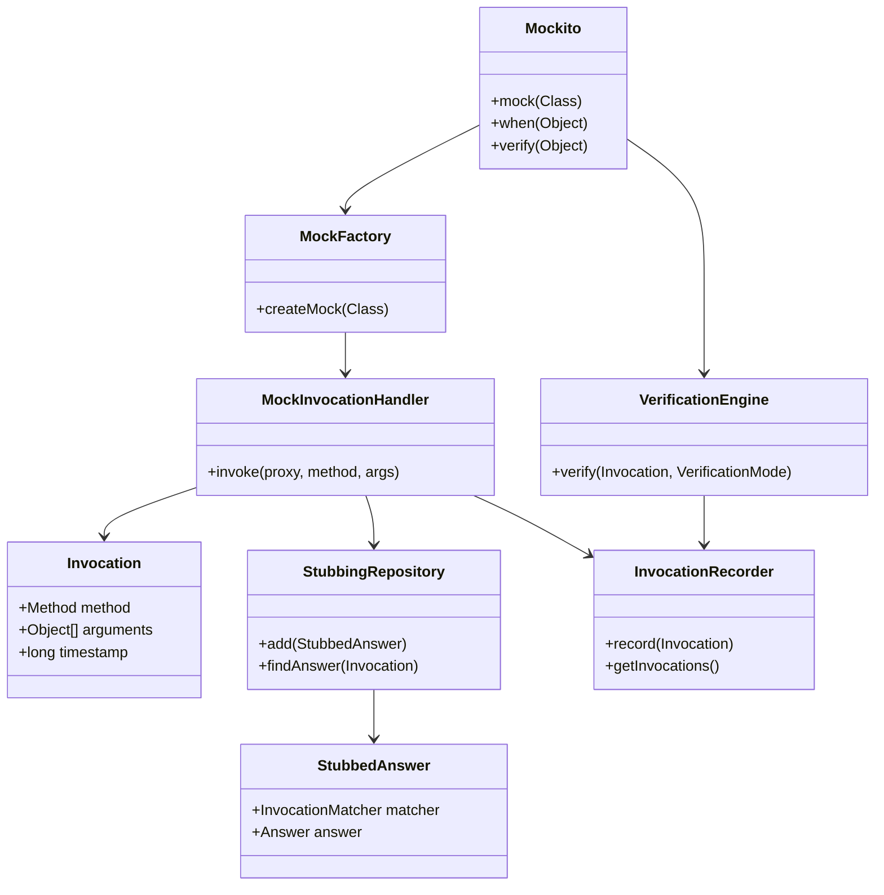

Build a framework that allows developers to create mock objects, define their behavior, and verify 
their interactions without depending on actual implementations.

---

### Class Diagram




Mockito needs to intercept every method invocation and understand:

1. Which mock was called?
2. Which method was called?
3. What arguments were passed?
4. What behaviour was configured for that invocation?

A regular implementation would need to manually implement every method and contain all this logic.
Instead, Mockito uses dynamic code generation, typically through Byte Buddy, to create a class that 
intercepts method calls.

Conceptually, the generated class behaves like this:

```java
class UserRepositoryMock implements UserRepository {

    private MockHandler handler;

    @Override
    public User findById(Long id) {
        return handler.handle(
            new Invocation(this, "findById", id)
        );
    }

    @Override
    public void deleteById(Long id) {
        handler.handle(
            new Invocation(this, "deleteById", id)
        );
    }
}
```

The important design decision is that method invocation and method behaviour are separated.
The generated class doesn't need to know whether `findById()` should return a user or throw an exception.
It simply delegates that decision to Mockito.s

---

### How `when(invocation).thenReturn(expectedOutput)` works?

Mockito primarily relies on a mock object's method interception mechanism. Let's break 
down the execution.

```java
// Step 1: Create a Mock Object
UserRepository repository =
    Mockito.mock(UserRepository.class);
```

Mockito creates a mock implementation of UserRepository. Internally, it typically uses 
Byte Buddy to generate a class that intercepts method calls.

```java
// Step 2: Calling when()
when(repositoryfindById(1L))
```

Java evaluates the argument to `when()` first. Therefore, `repository.findById(1L)` is 
executed before `when()` itself. Since this is a mock object, the invocation is 
intercepted by Mockito.

Mockito records information about the invocation, such as:

- Mock object reference.
- Method name: findById.
- Arguments: `1L`.

It also records the invocation as the potential stubbing target.

```java

```