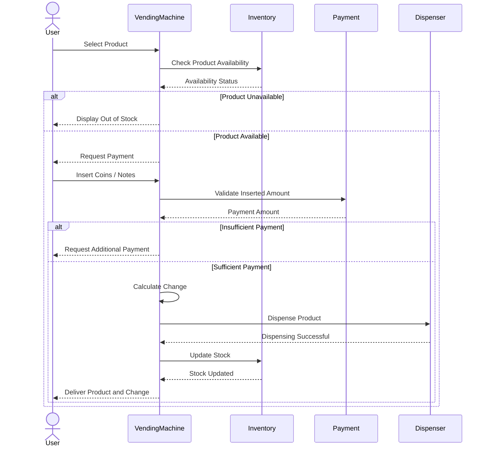

Design a vending machine system that allows users to select a product from a list of 
available items and purchase it by inserting cash. 

<VendingMachineVisualizer />

---

### Functional Requirements

The vendoring machine should support for the following operations:

1. Display all available products along with important details like name, price and 
the quantity available in stock.

2. Allow users to select a product and insert coins or notes as payment. Once the inserted 
amount is sufficient, the machine should dispense the product and return the change.

3. Manage product inventory by updating the available stock after every successful 
purchase to ensure accurate inventory tracking.

---

### Sequence Flow

The primary use case for the vending machine system is to allow users to select a product 
and purchase it by inserting coins or banknotes as payment. Here's how its workflow looks like:

1. **Select a product**: The user selects a `Product` from the available options.

2. **Insert payment**: The user inserts coins or banknotes as `Payment`.

3. **Validate payment**: The `VendingMachine` compares the `insertedAmount` with the `productPrice`.

    - If the amount is insufficient, the machine requests additional payment.
    - If the amount is sufficient, the purchase proceeds.
    - If the amount exceeds the price, the machine calculates the change to return.

4. **Dispense the product and change**: The `VendingMachine` dispenses the selected `Product` and
returns any applicable change.

5. **Update Inventory**: The `VendingMachine` updates the `Inventory` to reflect the reduced stock.



---

### Object Model Design 

The primary entities in the system include:

#### VendingMachine

Serves as the central controller for the system, handling product selection and dispensing,
managing product inventory and processing cash payments.

To prevent the `VendingMachine` from becoming a **God Object** (a class with too many 
responsibilities), it can act as a facade and delegate the responsibility of managing the 
product inventory and processing cash payments to specialized components.

```java
class VendingMachine {

    private Inventory inventory;

    public void selectProduct(Product product) {

    }

    public void processPayment(Payment payment) {

    }

    public void dispenseProduct(Product product, int quantity) {
        inventory.removeProduct(product, quantity);
    }

}
```

The VendingMachine should provide feedback at each stage to guide the user. For instance, 
it should display messages like "Insert money to proceed", "Select a product", or 
"Please collect your change". To handle this, we can use the **State Pattern**. ????

#### Inventory

```java
class Inventory {

    private Map<Product, Integer> stock;
    
    public void addProduct(Product product, int quantity) {
        stock.put(product, stock.getOrDefault(product, 0) + quantity);
    }

    public void removeProduct(Product product, int quantity) {
        if (stock.containsKey(product)) {
            int currentStock = stock.get(product);
            if (currentStock >= quantity) {
                stock.put(product, currentStock - quantity);
            } else {
                throw new InsufficientStockException();
            }
        } else {
            throw new ProductNotFoundException();
        }
    }
}
```

#### Product

```java
class Product {

    private String name;
    private double price;


    public Product(String name, double price) {
        this.name = name;
        this.price = price;
    }

    public double getPrice() {
        return price;
    }
    
}
```

---

### Follow-Up Questions

Q1. How to extend the system to support other payment methods such as card or UPI?


