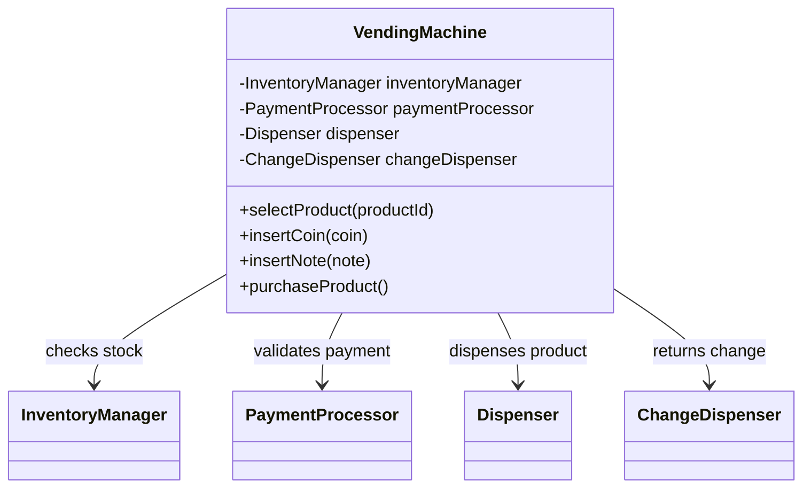
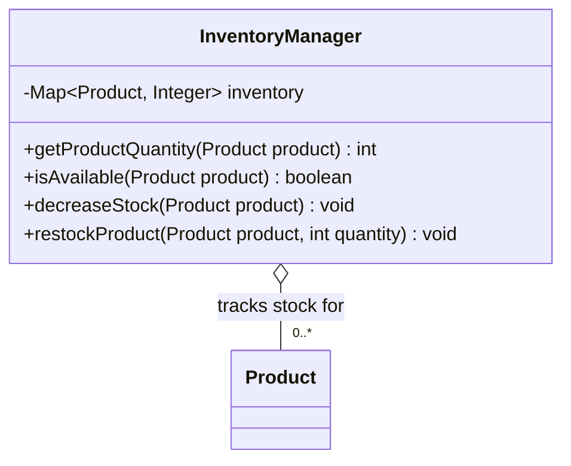
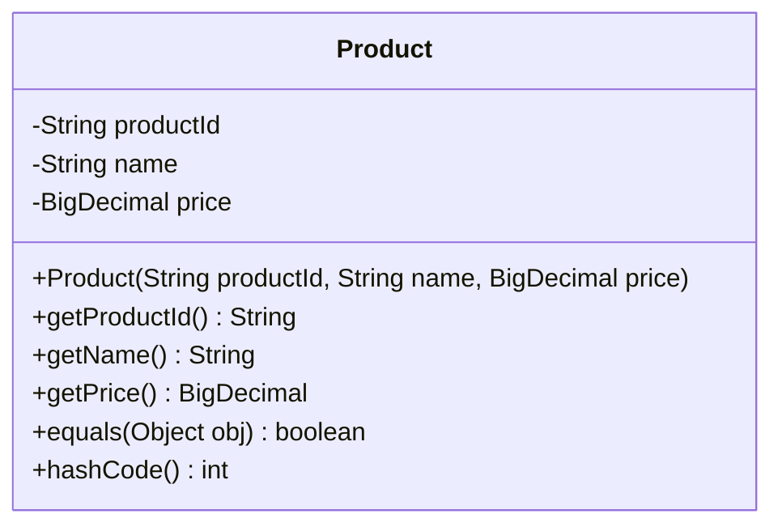
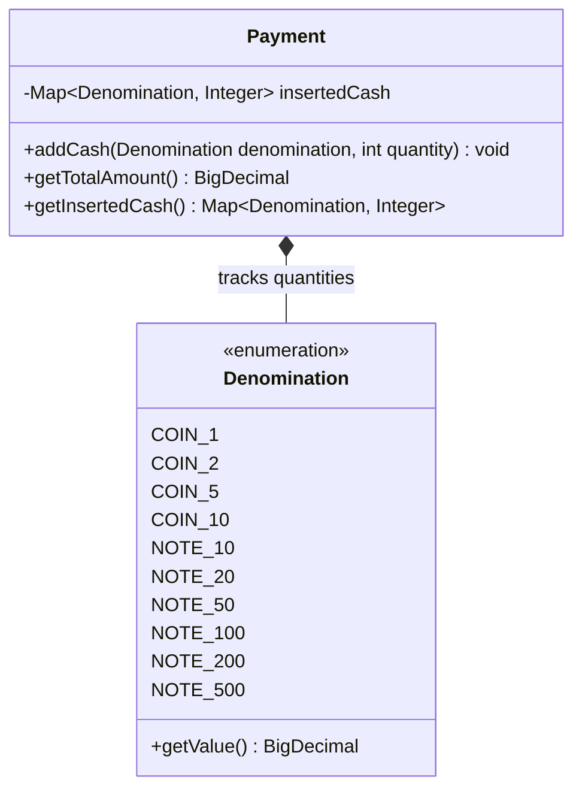
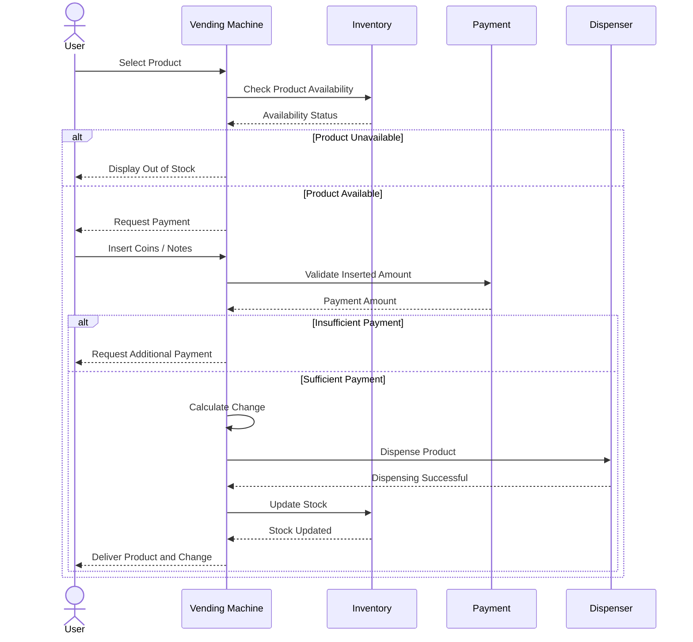

Design a vending machine system that allows users to select a product from a list of 
available items and purchase it by inserting cash. 

<VendingMachineVisualizer />

---

### Functional Requirements

The vendoring machine should support for the following operations:

1. Display all available products along with important details like name, price and 
the quantity available in stock.

2. Allow users to select a product and insert coins or notes as payment. Once the inserted 
amount is sufficient, the machine should dispense the product and return the change.

3. Manage product inventory by updating the available stock after every successful 
purchase to ensure accurate inventory tracking.

---

### Design Rationale 

Let's try to identify the key components of the vending machine system through the following design discussions.

##### **<span className="text-emerald-500">Q1. How can a user interact with the vending machine to fulfill a purchase request?</span>**

A user interacts with the vending machine through a set of public methods that allow them to select a product, insert coins or banknotes, 
and complete a purchase.

We introduce a `VendingMachine` class that acts as the central controller, coordinating product selection, payment validation, product 
dispensing, change calculation, and inventory updates.

To follow the **Single Responsibility Principle (SRP)**, we delegate inventory management, payment processing, and product dispensing to 
specialized components such as `InventoryManager`, `PaymentProcessor`, and `Dispenser`.



The `VendingMachine` also acts as a **Facade**, providing a unified and simplified interface to these subsystems while hiding their internal 
implementation details.

##### **<span className="text-emerald-500">Q2. How would you model the inventory to support efficient product lookups, availability checks, and stock updates?</span>**

We can model the inventory using a `Map<Product, Integer>`. This provides average-case `O(1)` lookup and update operations, assuming good hash distribution.

We'll keep the map **private** inside `InventoryManager` and expose inventory operations through methods such as `getProductQuantity()`, `isAvailable()`, 
`decreaseStock()`, and `restockProduct()`.

This encapsulates inventory management within `InventoryManager`, following the **Single Responsibility Principle (SRP)** and preventing other components from 
directly modifying stock quantities.



##### **<span className="text-emerald-500">Q3. How do we maintain a good hash distribution?</span>**

Since `Product` is used as a key in the `HashMap`, it must implement `equals()` and `hashCode()` consistently. Equal products must return the 
same hash code, and the fields used for equality and hashing should remain stable while the product is stored in the map.

To maintain a good hash distribution, `hashCode()` should minimize collisions by distributing distinct products across the available hash buckets. 
We can use an immutable, unique `productId` for equality and hash-code calculations, ensuring consistent lookup behavior even if other product 
attributes, such as `name` or `price`, change.



##### **<span className="text-emerald-500">Q4. How should the vending machine represent and track coins and banknotes inserted by the user?</span>**

We can represent the inserted cash using a `Map<Denomination, Integer>`, where Denomination represents a coin or banknote value and the integer 
represents its quantity.

We can encapsulate this map inside a `Payment` class, which is responsible for tracking the inserted denominations and calculating the total 
amount received.




---

### Sequence Flow

The primary use case for the vending machine system is to allow users to select a product 
and purchase it by inserting coins or banknotes as payment. Here's how its workflow looks like:

1. **Select a product**: The user selects a **<span className="text-emerald-500">product</span>** from the available options.

2. **Insert payment**: The user inserts coins or banknotes as **<span className="text-emerald-500">payment</span>**.

3. **Validate payment**: The **<span className="text-emerald-500">vending machine</span>** compares the 
**<span className="text-emerald-500">inserted amount</span>** with the **<span className="text-emerald-500">product price</span>**.

    - If the amount is insufficient, the machine requests additional payment.
    - If the amount is sufficient, the purchase proceeds.
    - If the amount exceeds the price, the machine calculates the change to return.

4. **Dispense the product and change**: The **<span className="text-emerald-500">vending machine</span>** dispenses the selected 
**<span className="text-emerald-500">product</span>** and returns any applicable change.

5. **Update Inventory**: The **<span className="text-emerald-500">vending machine</span>** updates the **<span className="text-emerald-500">inventory</span>** 
to reflect the reduced stock.



### Implementation

```java
class VendingMachine {

}
```

```python
class VendingMachine:


```

---

### Follow-Up Questions

Q1. How to extend the system to support other payment methods such as card or UPI?


