Design a vending machine system that allows users to select a product from a list of 
available items and purchase it by inserting cash. 

<VendingMachineVisualizer />

---

### Functional Requirements

The vendoring machine should support for the following operations:

1. Display all available products along with important details like name, price and 
the quantity available in stock.

2. Allow users to select a product and insert coins or notes as payment. Once the inserted 
amount is sufficient, the machine should dispense the product and return the change.

3. Manage product inventory by updating the available stock after every successful 
purchase to ensure accurate inventory tracking.

---

### Sequence Flow

The primary use case for the vending machine system is to allow users to select a product 
and purchase it by inserting coins or banknotes as payment. Here's how its workflow looks like:

1. **Select a product**: The user selects a **<span className="text-emerald-500">product</span>** from the available options.

2. **Insert payment**: The user inserts coins or banknotes as **<span className="text-emerald-500">payment</span>**.

3. **Validate payment**: The **<span className="text-emerald-500">vending machine</span>** compares the 
**<span className="text-emerald-500">inserted amount</span>** with the **<span className="text-emerald-500">product price</span>**.

    - If the amount is insufficient, the machine requests additional payment.
    - If the amount is sufficient, the purchase proceeds.
    - If the amount exceeds the price, the machine calculates the change to return.

4. **Dispense the product and change**: The **<span className="text-emerald-500">vending machine</span>** dispenses the selected 
**<span className="text-emerald-500">product</span>** and returns any applicable change.

5. **Update Inventory**: The **<span className="text-emerald-500">vending machine</span>** updates the **<span className="text-emerald-500">inventory</span>** 
to reflect the reduced stock.

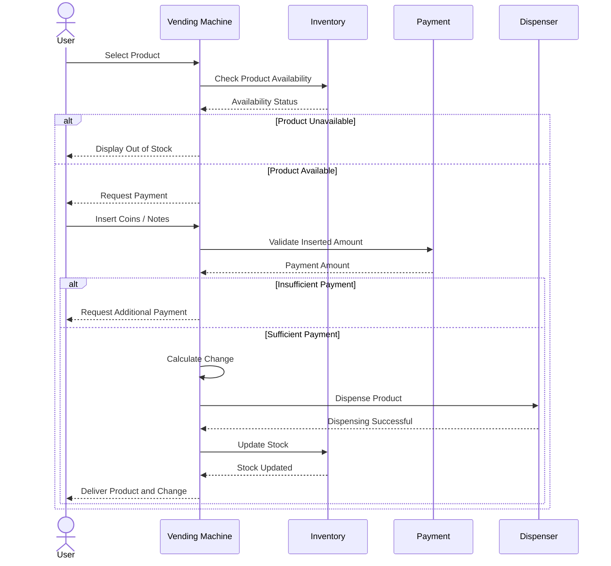

---

### Design Rationale

Let's try to identify the key components of the vending machine system through the following design discussions.

##### **<span className="text-emerald-500">Q1. How can a user interact with the vending machine to fulfill a purchase request?</span>**

A user interacts with the vending machine through a set of public methods that allow them to select a product, insert coins or banknotes, 
and complete a purchase.

We introduce a `VendingMachine` class that acts as the central controller, coordinating product selection, payment validation, product 
dispensing, change calculation, and inventory updates.

To follow the **Single Responsibility Principle (SRP)**, we delegate inventory management, payment processing, and product dispensing to 
specialized components such as `InventoryManager`, `PaymentProcessor`, `ProductDispenser`, and `ChangeDispenser`.

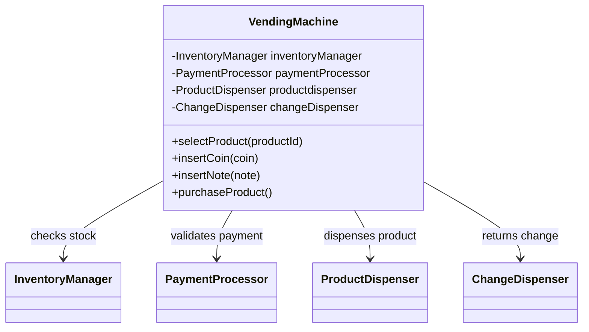

The `VendingMachine` also acts as a **Facade**, providing a unified and simplified interface to these subsystems while hiding their internal 
implementation details.

##### **<span className="text-emerald-500">Q2. How would you model the inventory to support efficient product lookups, availability checks, and stock updates?</span>**

We can model the inventory using a `Map<Product, Integer>`. This provides average-case `O(1)` lookup and update operations, assuming good hash distribution.

We'll keep the map **private** inside `InventoryManager` and expose inventory operations through methods such as `getProductQuantity()`, `isAvailable()`, 
`decreaseStock()`, and `restockProduct()`.

This encapsulates inventory management within `InventoryManager`, following the **Single Responsibility Principle (SRP)** and preventing other components from 
directly modifying stock quantities.

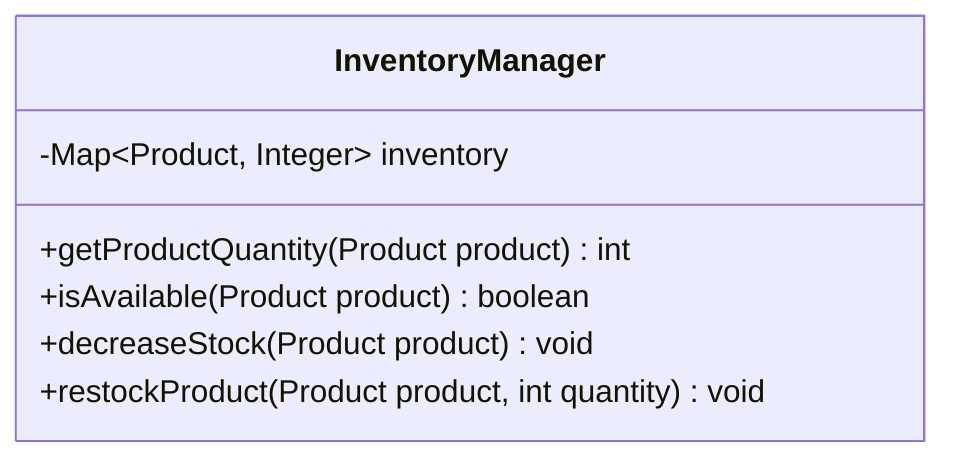

##### **<span className="text-emerald-500">Q3. How do we maintain a good hash distribution?</span>**

Since `Product` is used as a key in the `HashMap`, it must implement `equals()` and `hashCode()` consistently. Equal products must return the 
same hash code, and the fields used for equality and hashing should remain stable while the product is stored in the map.

To maintain a good hash distribution, `hashCode()` should minimize collisions by distributing distinct products across the available hash buckets. 
We can use an immutable, unique `productId` for equality and hash-code calculations, ensuring consistent lookup behavior even if other product 
attributes, such as `name` or `price`, change.

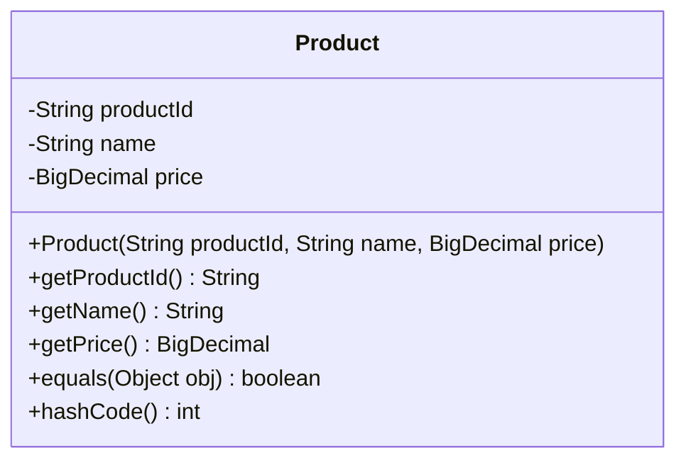

##### **<span className="text-emerald-500">Q4. How should the vending machine validate the inserted amount and determine the change due?</span>**

We'll introduce a `PaymentProcessor` class to validate the payment by comparing the total inserted amount with the product price. If the amount is insufficient, 
the machine requests additional payment. If the amount is sufficient, the purchase can proceed, and any excess amount is calculated as change due.

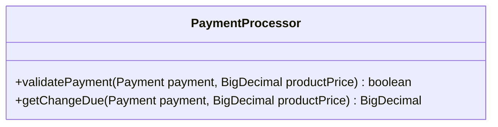

##### **<span className="text-emerald-500">Q5. How should the vending machine represent and track coins and banknotes inserted by the user?</span>**

We can represent the inserted cash using a `Map<Denomination, Integer>`, where Denomination represents a coin or banknote value and the integer 
represents its quantity.

We can encapsulate this map inside a `Payment` class, which is responsible for tracking the inserted denominations and calculating the total 
amount received. The `PaymentProcessor` uses this total to validate the payment and determine the change due.

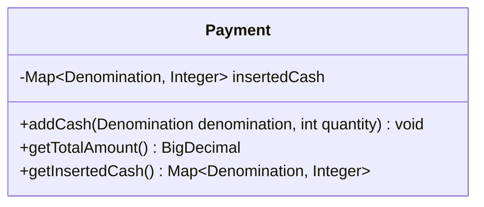

<Note>
`getInsertedCash()` should ideally return an unmodifiable view or a defensive copy so callers cannot bypass the `Payment` 
class and modify its internal state directly.
</Note>


##### **<span className="text-emerald-500">Q6. How should we model different coin and banknote denominations to ensure type safety and support cash handling and change dispensing?</span>**

We can model `Denomination` as an enum representing the coins and banknotes accepted by the vending machine. 
Using an enum provides type safety and immutability, ensuring that only predefined denominations are used.

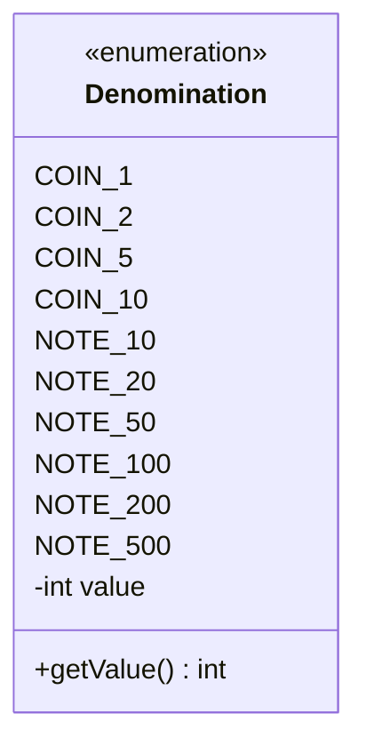

Each denomination has an associated monetary value, allowing the system to calculate the total inserted amount and determine the change due.
For example, `COIN_5(5)` represents a ₹5 coin, while `NOTE_5(5)` represents a `₹5` banknote, if both are supported. This distinction allows 
the machine to handle different physical cash types even when their monetary values are equal.

##### **<span className="text-emerald-500">Q7. How should the vending machine dispense the required change while ensuring sufficient cash is available?</span>**

We introduce a `ChangeDispenser` class responsible for selecting the appropriate coins and banknotes to return the required change. 
It interacts with `CashInventory` to check the availability of denominations and determine whether the requested amount can be dispensed.

The `ChangeDispenser` selects a combination of available denominations that adds up to the change due. If the required amount cannot be 
formed using the available cash, the machine must handle the failure without completing the purchase incorrectly.

Once a valid combination is selected, the dispenser returns the change and updates the cash inventory to reflect the dispensed denominations.

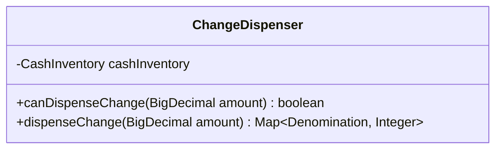

##### **<span className="text-emerald-500">Q8. How should the vending machine track available coins and banknotes to ensure it can return the correct change to users?</span>**

 We can represent the cash inventory using a `Map<Denomination, Integer>`, where `Denomination` represents a coin or banknote 
 value and the integer represents its available quantity.

We can encapsulate it inside a `CashInventory` class, making it responsible for checking denomination availability, updating quantities when cash is 
added or dispensed, and ensuring that sufficient cash is available to return the required change. 

The `ChangeDispenser` can use `CashInventory` to determine whether the required change can be provided and dispense the appropriate denominations.

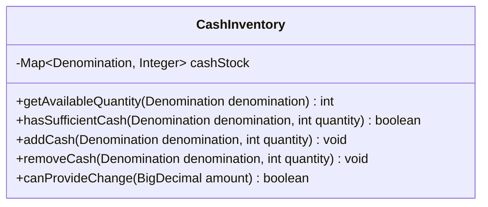

##### **<span className="text-emerald-500">Q9. How should the vending machine dispense the selected product?</span>**

We introduce a Dispenser class responsible for physically dispensing the selected product after payment has been validated 
and sufficient inventory has been confirmed.

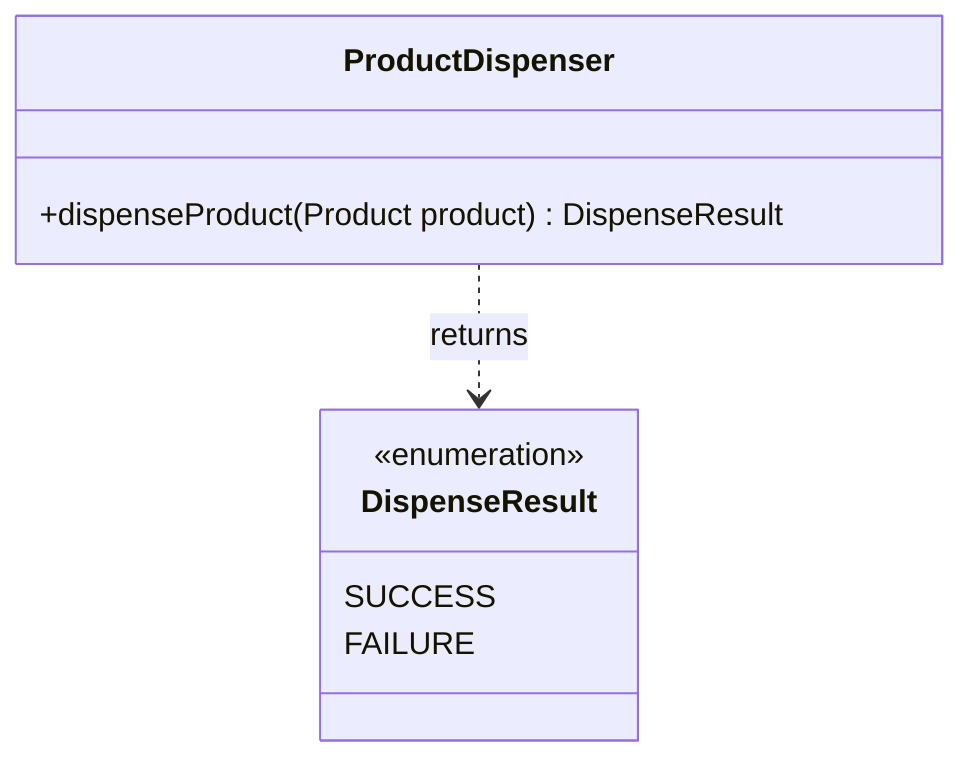

---

### Implementation

<CodeSamples>

```java

public final class VendingMachine {
    private final InventoryManager inventoryManager;
    private final PaymentProcessor paymentProcessor;
    private final Dispenser dispenser;
    private final ChangeDispenser changeDispenser;
    private final CashInventory cashInventory;

    public VendingMachine(
            InventoryManager inventoryManager,
            PaymentProcessor paymentProcessor,
            Dispenser dispenser,
            ChangeDispenser changeDispenser,
            CashInventory cashInventory) {
        if (inventoryManager == null || paymentProcessor == null || dispenser == null
                || changeDispenser == null || cashInventory == null) {
            throw new IllegalArgumentException("Dependencies cannot be null");
        }
        this.inventoryManager = inventoryManager;
        this.paymentProcessor = paymentProcessor;
        this.dispenser = dispenser;
        this.changeDispenser = changeDispenser;
        this.cashInventory = cashInventory;
    }

    public Product selectProduct(String productId) {
        Product product = inventoryManager.getProduct(productId);
        if (product == null) {
            throw new IllegalArgumentException("Unknown product: " + productId);
        }
        if (!inventoryManager.isAvailable(product)) {
            throw new IllegalStateException("Product is out of stock: " + product.getName());
        }
        return product;
    }

    public PurchaseResult purchaseProduct(String productId, Payment payment) {
        if (payment == null) throw new IllegalArgumentException("payment cannot be null");

        int inserted = payment.getTotalAmount();
        Product product = inventoryManager.getProduct(productId);
        if (product == null) {
            return result(PurchaseResult.Status.PRODUCT_NOT_FOUND, inserted, 0, Map.of(),
                    "Product not found");
        }
        if (!inventoryManager.isAvailable(product)) {
            return result(PurchaseResult.Status.OUT_OF_STOCK, inserted, 0, Map.of(),
                    "Product is out of stock");
        }
        if (!paymentProcessor.isSufficient(payment, product.getPrice())) {
            return result(PurchaseResult.Status.INSUFFICIENT_PAYMENT, inserted, 0, Map.of(),
                    "Please insert more cash");
        }

        int changeDue = paymentProcessor.calculateChangeDue(payment, product.getPrice());

        // Plan change before dispensing, so we don't dispense a product if change is unavailable.
        Map<Denomination, Integer> plannedChange = cashInventory.findChange(changeDue);
        if (plannedChange == null) {
            return result(PurchaseResult.Status.EXACT_CHANGE_UNAVAILABLE, inserted, changeDue,
                    Map.of(), "Unable to provide exact change; purchase not completed");
        }

        DispenseResult dispenseResult = dispenser.dispenseProduct(product);
        if (dispenseResult != DispenseResult.SUCCESS) {
            return result(PurchaseResult.Status.DISPENSING_FAILED, inserted, changeDue,
                    Map.of(), "Dispensing failed; refund/recovery is required");
        }

        // Commit product stock only after dispensing succeeds.
        inventoryManager.decreaseStock(product);

        /*
         * Cash inserted by the user enters the machine's cash inventory.
         * Then return change. In production, physical cash operations require
         * a transactional/reservation protocol and hardware-failure recovery.
         */
        payment.getInsertedCash().forEach(cashInventory::addCash);

        Map<Denomination, Integer> dispensedChange;
        try {
            dispensedChange = changeDispenser.dispenseChange(changeDue);
        } catch (RuntimeException e) {
            // Product has already been dispensed; production systems need compensation/manual recovery.
            return result(PurchaseResult.Status.EXACT_CHANGE_UNAVAILABLE, inserted, changeDue,
                    Map.of(), "Product dispensed but change delivery failed; recovery is required");
        }

        return result(PurchaseResult.Status.SUCCESS, inserted, changeDue, dispensedChange,
                "Purchase completed");
    }

    private PurchaseResult result(
            PurchaseResult.Status status,
            int inserted,
            int changeDue,
            Map<Denomination, Integer> change,
            String message) {
        return new PurchaseResult(status, inserted, changeDue, change, message);
    }
}
```

```java
public final class InventoryManager {
    private final Map<Product, Integer> inventory = new HashMap<>();

    public synchronized void addProduct(Product product, int quantity) {
        if (product == null) throw new IllegalArgumentException("product cannot be null");
        if (quantity <= 0) throw new IllegalArgumentException("quantity must be positive");
        inventory.merge(product, quantity, Math::addExact);
    }

    public synchronized Product getProduct(String productId) {
        return inventory.keySet().stream()
                .filter(p -> p.getProductId().equals(productId))
                .findFirst()
                .orElse(null);
    }

    public synchronized boolean isAvailable(Product product) {
        return product != null && inventory.getOrDefault(product, 0) > 0;
    }

    public synchronized int getProductQuantity(Product product) {
        return inventory.getOrDefault(product, 0);
    }

    public synchronized void decreaseStock(Product product) {
        int quantity = inventory.getOrDefault(product, 0);
        if (quantity <= 0) {
            throw new IllegalStateException("Product is out of stock");
        }
        inventory.put(product, quantity - 1);
    }

    public synchronized void increaseStock(Product product) {
        if (product == null) throw new IllegalArgumentException("product cannot be null");
        inventory.merge(product, 1, Math::addExact);
    }

    public synchronized Map<Product, Integer> snapshot() {
        return Map.copyOf(inventory);
    }
}
```

```java
public final class PaymentProcessor {
    public boolean isSufficient(Payment payment, int productPrice) {
        if (payment == null) throw new IllegalArgumentException("payment cannot be null");
        if (productPrice <= 0) throw new IllegalArgumentException("productPrice must be positive");
        return payment.getTotalAmount() >= productPrice;
    }

    public int calculateChangeDue(Payment payment, int productPrice) {
        if (!isSufficient(payment, productPrice)) {
            throw new IllegalStateException("Insufficient payment");
        }
        return payment.getTotalAmount() - productPrice;
    }
}
```

```java
public interface Dispenser {
    DispenseResult dispenseProduct(Product product);
}
```

```java
public final class ChangeDispenser {
    private final CashInventory cashInventory;

    public ChangeDispenser(CashInventory cashInventory) {
        if (cashInventory == null) throw new IllegalArgumentException("cashInventory cannot be null");
        this.cashInventory = cashInventory;
    }

    public boolean canDispenseChange(int amount) {
        return cashInventory.findChange(amount) != null;
    }

    public Map<Denomination, Integer> dispenseChange(int amount) {
        Map<Denomination, Integer> change = cashInventory.findChange(amount);
        if (change == null) {
            throw new IllegalStateException("Exact change is unavailable");
        }
        cashInventory.removeChange(change);
        return change;
    }
}
```

```java
public final class CashInventory {
    private final Map<Denomination, Integer> cashStock =
            new EnumMap<>(Denomination.class);

    public synchronized void addCash(Denomination denomination, int quantity) {
        validate(denomination, quantity);
        cashStock.merge(denomination, quantity, Math::addExact);
    }

    public synchronized int getAvailableQuantity(Denomination denomination) {
        return cashStock.getOrDefault(denomination, 0);
    }

    public synchronized boolean hasSufficientCash(Denomination denomination, int quantity) {
        return quantity >= 0 && getAvailableQuantity(denomination) >= quantity;
    }

    public synchronized void removeCash(Denomination denomination, int quantity) {
        validate(denomination, quantity);
        int available = cashStock.getOrDefault(denomination, 0);
        if (quantity > available) {
            throw new IllegalStateException("Insufficient " + denomination + " in cash inventory");
        }
        cashStock.put(denomination, available - quantity);
    }

    public synchronized Map<Denomination, Integer> snapshot() {
        return Collections.unmodifiableMap(new EnumMap<>(cashStock));
    }

    /*
     * Finds an exact change combination with bounded quantities.
     * Returns null when no exact combination is possible.
     */
    public synchronized Map<Denomination, Integer> findChange(int amount) {
        if (amount < 0) throw new IllegalArgumentException("amount cannot be negative");
        EnumMap<Denomination, Integer> result = new EnumMap<>(Denomination.class);
        if (findChangeRecursive(amount, Denomination.values(), 0, result)) {
            return result;
        }
        return null;
    }

    private boolean findChangeRecursive(
            int remaining,
            Denomination[] denominations,
            int index,
            Map<Denomination, Integer> result) {
        if (remaining == 0) return true;
        if (index >= denominations.length || remaining < 0) return false;

        Denomination denomination = denominations[index];
        int value = denomination.getValue();
        int maxAvailable = Math.min(
                getAvailableQuantity(denomination),
                remaining / value
        );

        // Try larger quantities of this denomination first.
        for (int count = maxAvailable; count >= 0; count--) {
            if (count > 0) result.put(denomination, count);
            else result.remove(denomination);

            if (findChangeRecursive(
                    remaining - count * value, denominations, index + 1, result)) {
                return true;
            }
        }
        result.remove(denomination);
        return false;
    }

    public synchronized void removeChange(Map<Denomination, Integer> change) {
        for (Map.Entry<Denomination, Integer> entry : change.entrySet()) {
            if (!hasSufficientCash(entry.getKey(), entry.getValue())) {
                throw new IllegalStateException("Cash inventory changed before dispensing change");
            }
        }
        change.forEach(this::removeCash);
    }

    private static void validate(Denomination denomination, int quantity) {
        if (denomination == null) throw new IllegalArgumentException("denomination cannot be null");
        if (quantity <= 0) throw new IllegalArgumentException("quantity must be positive");
    }
}
```

```java
public final class Payment {
    private final Map<Denomination, Integer> insertedCash =
            new EnumMap<>(Denomination.class);

    public void addCash(Denomination denomination, int quantity) {
        if (denomination == null) {
            throw new IllegalArgumentException("denomination cannot be null");
        }
        if (quantity <= 0) {
            throw new IllegalArgumentException("quantity must be positive");
        }
        insertedCash.merge(denomination, quantity, Math::addExact);
    }

    public int getTotalAmount() {
        int total = 0;
        for (Map.Entry<Denomination, Integer> entry : insertedCash.entrySet()) {
            total = Math.addExact(
                    total,
                    Math.multiplyExact(entry.getKey().getValue(), entry.getValue())
            );
        }
        return total;
    }

    public Map<Denomination, Integer> getInsertedCash() {
        return Collections.unmodifiableMap(new EnumMap<>(insertedCash));
    }
}
```

```java
public enum DispenseResult {
    SUCCESS,
    FAILURE
}
```

```java
public enum Denomination {
    COIN_1(1, CashType.COIN),
    COIN_2(2, CashType.COIN),
    COIN_5(5, CashType.COIN),
    COIN_10(10, CashType.COIN),
    NOTE_10(10, CashType.NOTE),
    NOTE_20(20, CashType.NOTE),
    NOTE_50(50, CashType.NOTE),
    NOTE_100(100, CashType.NOTE),
    NOTE_200(200, CashType.NOTE),
    NOTE_500(500, CashType.NOTE);

    private final int value;
    private final CashType type;

    Denomination(int value, CashType type) {
        this.value = value;
        this.type = type;
    }

    public int getValue() {
        return value;
    }

    public CashType getType() {
        return type;
    }

    public enum CashType {
        COIN, NOTE
    }
}
```

```java
public final class Product {
    private final String productId;
    private final String name;
    private final int price; // Whole rupees for this example.

    public Product(String productId, String name, int price) {
        if (productId == null || productId.isBlank()) {
            throw new IllegalArgumentException("productId cannot be blank");
        }
        if (name == null || name.isBlank()) {
            throw new IllegalArgumentException("name cannot be blank");
        }
        if (price <= 0) {
            throw new IllegalArgumentException("price must be positive");
        }
        this.productId = productId;
        this.name = name;
        this.price = price;
    }

    public String getProductId() {
        return productId;
    }

    public String getName() {
        return name;
    }

    public int getPrice() {
        return price;
    }

    // Product identity is based on its stable, immutable ID.
    @Override
    public boolean equals(Object other) {
        if (this == other) return true;
        if (!(other instanceof Product)) return false;
        Product product = (Product) other;
        return productId.equals(product.productId);
    }

    @Override
    public int hashCode() {
        return Objects.hash(productId);
    }

    @Override
    public String toString() {
        return name + " (₹" + price + ")";
    }
}
```

```java
public final class PurchaseResult {
    public enum Status {
        SUCCESS,
        PRODUCT_NOT_FOUND,
        OUT_OF_STOCK,
        INSUFFICIENT_PAYMENT,
        EXACT_CHANGE_UNAVAILABLE,
        DISPENSING_FAILED
    }

    private final Status status;
    private final int amountInserted;
    private final int changeDue;
    private final Map<Denomination, Integer> changeDispensed;
    private final String message;

    public PurchaseResult(
            Status status,
            int amountInserted,
            int changeDue,
            Map<Denomination, Integer> changeDispensed,
            String message) {
        this.status = status;
        this.amountInserted = amountInserted;
        this.changeDue = changeDue;
        this.changeDispensed = Map.copyOf(changeDispensed);
        this.message = message;
    }

    public Status getStatus() { return status; }
    public int getAmountInserted() { return amountInserted; }
    public int getChangeDue() { return changeDue; }
    public Map<Denomination, Integer> getChangeDispensed() { return changeDispensed; }
    public String getMessage() { return message; }

    @Override
    public String toString() {
        return "PurchaseResult{" +
                "status=" + status +
                ", amountInserted=₹" + amountInserted +
                ", changeDue=₹" + changeDue +
                ", changeDispensed=" + changeDispensed +
                ", message='" + message + '\'' +
                '}';
    }
}
```

```java
public final class SimulatedDispenser implements Dispenser {
    @Override
    public DispenseResult dispenseProduct(Product product) {
        // Replace with hardware integration in a real vending machine.
        System.out.println("Dispensing: " + product.getName());
        return DispenseResult.SUCCESS;
    }
}
```

</CodeSamples>

---

### Final Design

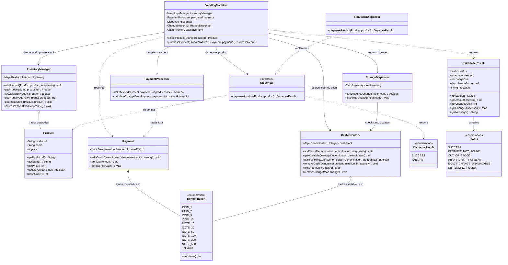

---

### Follow-Up Questions

Q1. How to extend the system to support other payment methods such as card or UPI?


